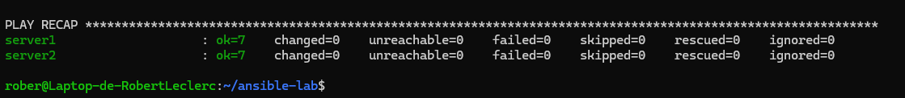

# Laboratorio Ansible con Docker

## 1. Objetivo
Crear y administrar dos servidores Ubuntu mediante Ansible
utilizando contenedores Docker.

## 2. Tecnologías utilizadas
- Docker
- Docker Compose
- Ubuntu 24.04
- Ansible
- Python 3

## 3. Estructura del proyecto
- docker-compose.yml
- inventory.ini
- playbook.yml
- README.md

## 4. Crear los servidores
```bash
docker compose up -d
```

## 5. Instalar Python
```bash
docker exec server1 bash -c "apt-get update && apt-get install -y python3"
docker exec server2 bash -c "apt-get update && apt-get install -y python3"
```

## 6. Instalar colección Docker
```bash
ansible-galaxy collection install community.docker
```

## 7. Comprobar conexión
```bash
ansible servers -i inventory.ini -m ping
```

## 8. Ejecutar Playbook
```bash
ansible-playbook -i inventory.ini playbook.yml
```

## 9. Verificar resultados
```bash
docker exec server1 ls -R /tmp/ansible-demo
docker exec server2 ls -R /tmp/ansible-demo
```

## 10. Resultados
Se crearon correctamente los directorios y archivos
en ambos servidores Ubuntu.
Las tareas de Ansible finalizaron sin errores.

## Evidencia de ejecución

A continuación, se muestra la ejecución exitosa del
Playbook de Ansible en los dos servidores Docker.

